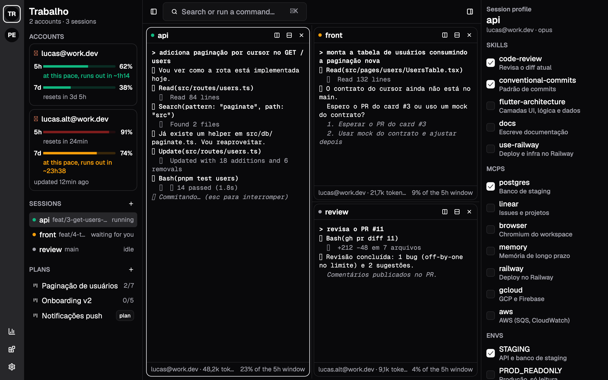
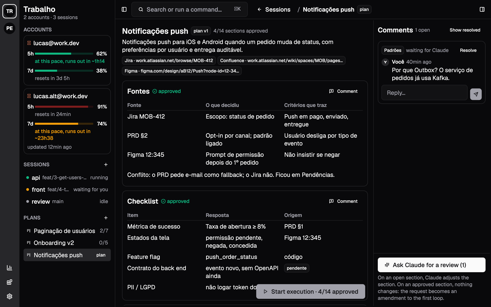
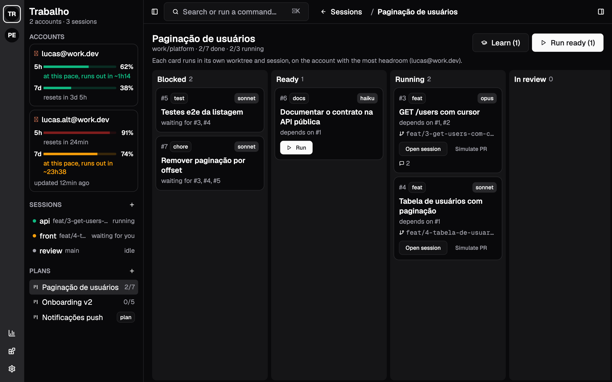
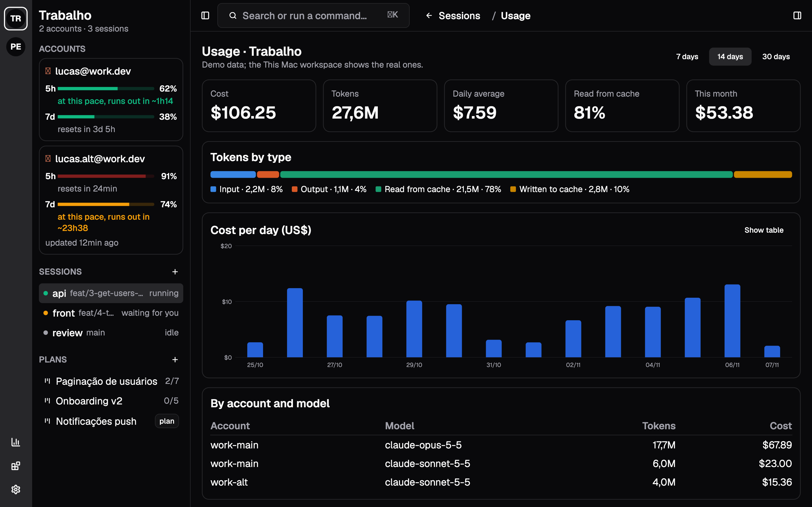
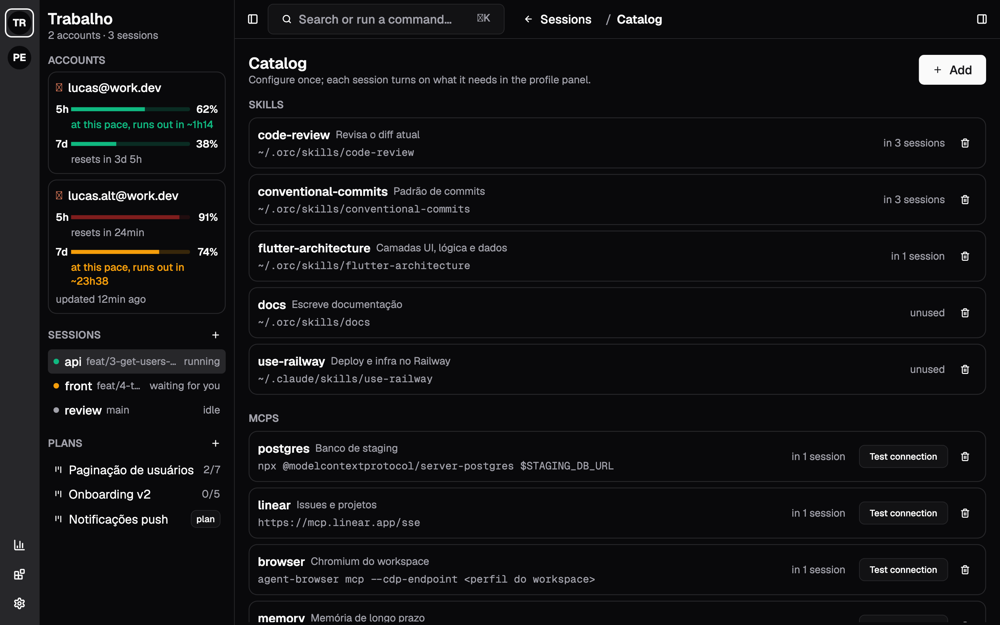
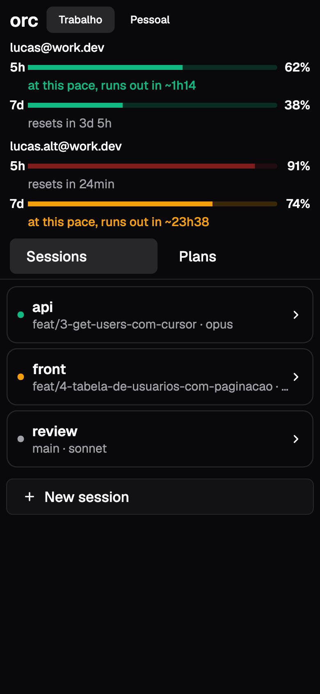
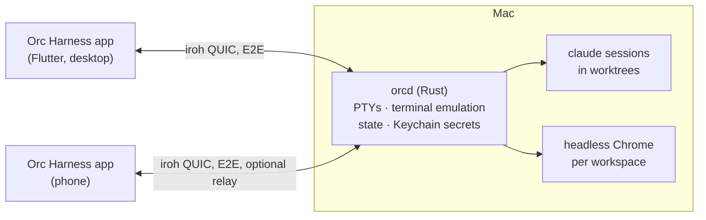

<div align="center">


# Orc Harness

**Run many Claude Code sessions in parallel, across accounts and workspaces, from your desktop and your phone.**

[](https://github.com/Lukitaduarte/orc-harness/actions/workflows/ci.yml)
[](https://github.com/Lukitaduarte/orc-harness/releases)
[](LICENSE)


[](CONTRIBUTING.md)

English · [Português](README.pt-BR.md)



</div>

> *"Work, work."* Each session gets its own skills, MCPs and envs. Approved plans become cards that run in git worktrees until they turn into PRs, and each account's quota decides where and when each card runs.

## Features

- **Sessions**: real terminals (the daemon emulates, the app draws) in split, resizable panes. Sessions survive daemon restarts with their conversation, and you get notified when one is waiting on you.
- **Accounts and workspaces**: several Claude Code accounts, each with its own config dir. Workspaces (e.g. Work, Personal) group accounts, repos, plans, browser and memory. Every account's 5-hour and weekly quota stays in sight.
- **Profiles**: skills, MCPs and envs picked per session from a global catalog and applied with a restart (`--resume`). Env values live in the Keychain and never reach files or the app.
- **Plan mode**: markdown templates (backend with deploy, app with release, spike). A planning session writes the plan and answers comments; you approve it section by section, and comments on approved sections become amendments.
- **Execution**: plan loops become a DAG of cards. Each card runs in its own worktree, on the account with the most headroom. An open PR moves it to review; the merge moves it to done and unblocks what depended on it. Conventional commits only.
- **Exit gates**: deploys (Railway, GCP, AWS, Firebase, Vercel, Fly), store releases, `kubectl`, `helm`, `terraform`, pushes to `main`, merges and package publishing wait for your OK in the app, from the phone too.
- **Sessions that talk**: the harness MCP (`orc`) gives every session `list_sessions`, `send_message`, `read_inbox`, `delegate_task`, `search_code`, `list_envs`, `request_env_change` and memory (`remember`, `recall`, `forget`).
- **Learn**: comments on cards become proposed edits to your skills, applied only with your OK.
- **Memory per workspace**: the harness's own, or a memory MCP from the catalog (mem0, basic-memory…).
- **Browser per workspace**: headless Chrome with its own profile (cookies and logins persist), shown in a pane and driven by agents through Playwright MCP. The toolbar shows when an agent is using it.
- **IDE**: file tree and tabs, completion, diagnostics, go to definition, hover and formatting through language servers (Dart, TypeScript, Kotlin, Swift); diff against base, commit, push and merge; open in Xcode, Android Studio or Zed.
- **Analytics**: tokens and cost straight from Claude Code (OpenTelemetry) by day, account, model, plan and branch; cache hit rate; monthly budgets per workspace.
- **Phone**: the same app, with quotas on top, sessions with a typing bar, and plan review and approval. Pair by scanning a QR code.
- **Languages**: English, Português and Español.

<table>
  <tr>
    <td></td>
    <td></td>
  </tr>
  <tr>
    <td align="center">Plan review, section by section</td>
    <td align="center">Cards running in worktrees</td>
  </tr>
  <tr>
    <td></td>
    <td></td>
  </tr>
  <tr>
    <td align="center">Usage and cost</td>
    <td align="center">Skills, MCPs and envs catalog</td>
  </tr>
</table>

<p align="center"></p>

## Install (macOS)

```sh
brew install --cask lukitaduarte/tap/orc-harness
```

Open **Orc Harness** and that's it: on first launch the app installs its daemon (`orcd`) as a login service and connects to it. You need [Claude Code](https://docs.claude.com/en/docs/claude-code) (`claude`); `gh` and Google Chrome are optional.

Then create a workspace (**+** in the left bar), add an account (**New account** opens a session for `/login`) and add repositories. To use your phone, run `orcd pair` and scan the QR code, or open ⚙ → **Connect daemon** on a paired device.

<details>
<summary>Without Homebrew</summary>

Download `OrcHarness-<version>-macos.dmg` from the [latest release](https://github.com/Lukitaduarte/orc-harness/releases/latest) and drag **Orc Harness** to Applications. Builds are not notarized yet, so the first time macOS blocks it: open **System Settings → Privacy & Security** and click **Open Anyway** (or run `xattr -dr com.apple.quarantine "/Applications/Orc Harness.app"`).

For a daemon without the app (e.g. on a Mac you only reach from your phone), use `orcd-<version>-macos-universal.tar.gz`: extract it, run `./orcd install` and then `~/.orc/bin/orcd pair`.

`orcd install --sign "Apple Development: Your Name (TEAMID)"` signs the installed copies so the Keychain and firewall don't ask again after each update.
</details>

**Uninstall:** `brew uninstall --cask orc-harness` stops and removes the service; add `--zap` to delete `~/.orc` too.

## Build from source

Requires stable Rust and Flutter 3.38+.

```sh
cargo build --release --bins
./target/release/orcd serve          # keep it running (or: orcd install)
./target/release/orcd pair
cd app && flutter run -d macos
```

To reach the daemon away from your network, set a relay in `~/.orc/config.json`: `{ "relay": "n0" }` (n0's public relays) or the URL of your own `iroh-relay`. The default `"off"` keeps it on the local network. Paired devices are listed, and can be revoked, in ⚙ → Connect daemon, or with `orcd devices` / `orcd revoke ID`.

## Architecture



- **`orcd`**, the Rust daemon, owns the sessions (PTY and emulated terminal), processes, state and secrets.
- **The app** ([Flutter](https://flutter.dev) with [shadcn_flutter](https://pub.dev/packages/shadcn_flutter)) is only a client, on desktop and phone.
- **Transport** is [iroh](https://iroh.computer) (QUIC, peer to peer): only paired keys get in, and traffic is end-to-end encrypted.

```
app/                Flutter app (desktop + mobile)
app/rust/           Flutter ↔ Rust bridge (flutter_rust_bridge)
crates/protocol/    shared messages and types
crates/link/        iroh: tickets, keys, endpoints, relay
crates/daemon/      orcd + orc-statusline, orc-hook, orc-commit-check, orc-mcp
crates/client-core/ app side: pairing and connecting
```

Everything lives in `~/.orc` (or `$ORC_HOME`): JSON config you can edit by hand (`config.json`, `workspaces.json`, `catalog.json`…), plan templates in `templates/*.md`, plans in `plans/<id>/`, and usage and agent memory in `orc.db` ([Turso](https://turso.tech), SQLite format). Secrets are in the Keychain under the `orc-harness` service.

## Languages

The app follows the system language; pick another in ⚙ → Language. Strings live in `app/lib/l10n/app_<code>.arb`, one file per language, with `app_en.arb` as the template. To add one:

1. Copy `app_en.arb` to `app_<code>.arb`, change `@@locale`, and translate the values (not the keys or `{placeholders}`).
2. Add the language to `languageNames` in `app/lib/src/i18n.dart`.
3. Run `flutter gen-l10n` and `flutter test test/i18n_test.dart`, which checks nothing is missing.

## Tests

```sh
cargo test --workspace     # daemon, protocol, iroh end to end (uses Chrome and dart if present)
cd app && flutter test     # app
cd app && flutter test test_screenshots   # regenerates docs/screenshots
```

## Contributing

Issues and PRs are welcome: see [CONTRIBUTING.md](CONTRIBUTING.md) and the [Code of Conduct](CODE_OF_CONDUCT.md). Report vulnerabilities privately as described in [SECURITY.md](SECURITY.md).

## License

[MIT](LICENSE) © 2026 Lucas Duarte

---

<sub>Orc Harness is an independent project. It is not affiliated with or endorsed by Anthropic; Claude and Claude Code are trademarks of Anthropic. The orc theme is a fan homage to classic real-time strategy games; it is not affiliated with Blizzard Entertainment, and its pixel art is original.</sub>
