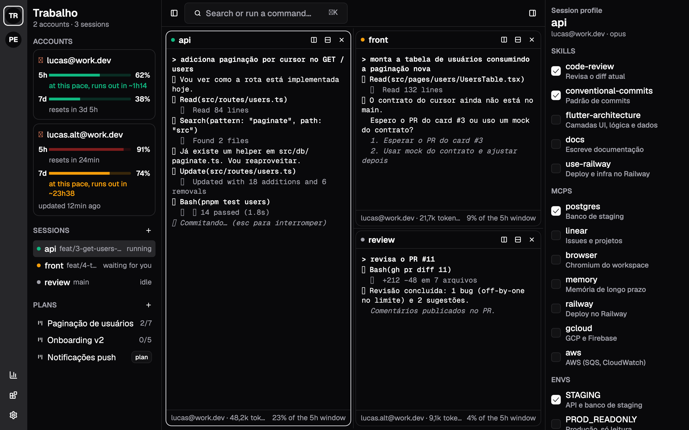

# Orc Harness

[English](README.md) · Português

Um harness para o Claude Code. Roda várias sessões em paralelo, em várias contas e workspaces, cada uma com o seu conjunto de skills, MCPs e envs. Planos aprovados viram cards, que rodam em worktrees até virar PR, e a cota de cada conta decide onde e quando cada card roda. Tudo pelo app no desktop e no celular.



## O que tem

- **Sessões**:
  - terminais de verdade (o daemon emula e o app desenha), em panes divididos e redimensionáveis;
  - cada sessão volta depois de um restart do daemon, com a conversa;
  - avisos quando uma sessão espera você.
- **Contas e workspaces**:
  - várias contas do Claude Code, cada uma com a própria pasta de configuração;
  - workspaces (ex.: Trabalho, Pessoal) agrupam contas, repositórios, planos, navegador e memória;
  - a cota de 5h e da semana de cada conta fica sempre à vista.
- **Perfis**: skills, MCPs, envs e os conectores do claude.ai da conta (Gmail, Drive, Slack…) escolhidos por sessão a partir de um catálogo global, aplicados com restart (`--resume`). Os MCPs que você já usa no Claude Code entram com um clique (Importar do Claude Code). Os valores das envs ficam no Keychain e nunca vão para arquivos nem para o app.
- **Plan mode**:
  - templates em markdown (back end com deploy, app com release, spike);
  - uma sessão de planejamento do Claude escreve o plano e responde aos comentários;
  - as seções são aprovadas uma a uma, com digest;
  - os comentários em seções já aprovadas viram emendas.
- **Execução**:
  - os loops do plano viram cards (um DAG com o modelo de cada card);
  - cada card roda na própria worktree, na conta com mais folga;
  - PR aberto move o card para review, e o merge move para feito e libera os cards que dependiam dele;
  - commits só em conventional commits.
- **Trava de saída**: tudo isto espera o seu OK no app, também pelo celular: deploy (Railway, GCP, AWS, Firebase, Vercel, Fly), release nas lojas, kubectl, helm, terraform, push na main, merge e publicação de pacote.
- **Sessões que conversam**: o MCP do harness (`orc`) dá a cada sessão as tools:
  - `list_sessions`, `send_message`, `read_inbox` e `delegate_task`;
  - `search_code`;
  - `list_envs`, `request_env_change` e `request_mcp_add` (o agente pede um MCP e você aprova no app);
  - memória: `remember`, `recall` e `forget`;
  - no planejamento e no Learn: `save_plan` e `propose_learning`.
- **Learn**: os comentários nos cards viram propostas de edição nas skills, aplicadas só com o seu OK.
- **Memória por workspace**: a do harness ou um MCP de memória do catálogo (mem0, basic-memory…).
- **Navegador por workspace**: Chrome headless com perfil próprio, onde ficam cookies e logins. Ele aparece num pane e os agentes o usam pelo Playwright MCP.
- **IDE**:
  - árvore e abas, autocomplete, erros, ir para definição, informação do símbolo e formatação, pelo servidor de linguagem (Dart, TypeScript, Kotlin, Swift);
  - abrir no Xcode, Android Studio ou Zed;
  - diff contra a base, commit, push e merge do PR;
  - busca de texto e de símbolos.
- **Analytics**:
  - tokens e custo do próprio Claude Code (OpenTelemetry), por dia, conta, modelo, plano e branch;
  - taxa de cache;
  - orçamento mensal por workspace, com avisos.
- **Celular**: o mesmo app, com cotas no topo, sessões com barra de digitação e revisão e aprovação de planos. O pareamento é por QR.

## Arquitetura

- **`orcd`, o daemon em Rust**: dono das sessões (PTY e terminal emulado), dos processos, do estado e dos segredos.
- **App em Flutter** (`shadcn_flutter`): só cliente, no desktop e no celular.
- **Transporte via iroh (QUIC P2P)**: só chaves pareadas entram. O relay é opcional e o tráfego é cifrado de ponta a ponta.

```
app/                Flutter (desktop + mobile)
app/rust/           ponte Flutter ↔ Rust (flutter_rust_bridge), workspace próprio
crates/protocol/    mensagens e tipos compartilhados
crates/link/        iroh: tickets, chaves, endpoints, relay
crates/daemon/      orcd + orc-statusline, orc-hook, orc-commit-check, orc-mcp
crates/client-core/ lado do app: parear e conectar
```

## Instalar (macOS)

```sh
brew install --cask lukitaduarte/tap/orc-harness
```

Abra o **Orc Harness** e pronto: na primeira vez o app instala o daemon (`orcd`) como serviço do login e se conecta a ele. Precisa do [Claude Code](https://docs.claude.com/en/docs/claude-code) (`claude`). Para o celular, rode `orcd pair` e escaneie o QR.

Sem o Homebrew: baixe o `.dmg` da [última release](https://github.com/Lukitaduarte/orc-harness/releases/latest), arraste para Aplicativos e, na primeira vez, vá em **Ajustes do Sistema → Privacidade e Segurança → Abrir Mesmo Assim**.

## Desenvolvimento


Precisa de: Rust estável, Flutter 3.38+, Claude Code (`claude`) e, opcionalmente, `gh`, Chrome e `dart` ou outros servidores de linguagem.

```sh
cargo build --release --bins
./target/release/orcd serve          # deixa rodando (ou: orcd install, veja abaixo)
./target/release/orcd pair           # imprime o ticket orc1… e um QR
cd app && flutter run -d macos       # ⚙ → Conectar daemon → cole o ticket (ou escaneie no celular)
```

No app, crie um workspace (**+** na barra da esquerda) e adicione contas (**Nova conta** abre uma sessão para o `/login`). Depois adicione repositórios em "Este Mac" e clique em "Confiar nas worktrees" uma vez.

### Como serviço (sobe no login)

```sh
./target/release/orcd install --sign "Apple Development: Seu Nome (TEAMID)"
orcd status
orcd uninstall
```

O `install` copia os binários para `~/.orc/bin`, assina-os (assim o Keychain e o firewall não perguntam de novo a cada atualização) e cria um LaunchAgent com o PATH do seu shell. O log fica em `~/.orc/orcd.log`.

### Fora da rede local

Em `~/.orc/config.json`:

```json
{ "relay": "n0" }
```

As opções são `"off"` (padrão, só a mesma rede), `"n0"` (relays públicos da n0) ou a URL do seu `iroh-relay`. Os aparelhos pareados ficam em ⚙ → Conectar daemon, onde também dá para revogar. Pelo terminal: `orcd devices` e `orcd revoke ID`.

## Onde ficam as coisas

Fica tudo em `~/.orc` (ou em `ORC_HOME`). Os arquivos de configuração são JSON, para você editar à mão:
- `config.json`: contas, relay e caminho do `claude`;
- `workspaces.json`, `catalog.json`, `projects.json`, `devices.json`;
- `templates/*.md`: templates de plan mode;
- `plans/<id>/`: `plan.md`, revisão, execução e learnings.

O resto:
- `orc.db` (Turso, formato SQLite): uso (tokens e custo) e a memória dos agentes;
- `sessions/`: uma pasta por sessão com a config gerada, mais `sessions.json`;
- `worktrees/`, `browsers/` (perfis do Chrome) e `accounts/` (contas criadas pelo app);
- segredos (valores de envs e a chave do daemon): no Keychain, serviço `orc-harness`. Em desenvolvimento, `ORC_SECRETS=file` guarda num arquivo 0600.

## Idiomas

O app vem em português, inglês e espanhol e segue o idioma do sistema. Dá para escolher outro em ⚙ → Idioma.

Os textos ficam em `app/lib/l10n/app_<código>.arb`, um arquivo por idioma; o `app_en.arb` é o modelo e traz a descrição e os parâmetros de cada texto. Para adicionar um idioma:

1. Copie `app_en.arb` para `app_<código>.arb` (ex.: `app_fr.arb`), troque o `@@locale` e traduza os valores. Não traduza as chaves nem os `{parâmetros}`.
2. Acrescente o idioma em `languageNames`, em `app/lib/src/i18n.dart`.
3. Rode `flutter gen-l10n` (ou só `flutter run`) e `flutter test test/i18n_test.dart`, que confere se nenhuma chave ficou faltando.

As falas do orc ("Work, work.", "Zug zug!") ficam em inglês em todos os idiomas.

## Licença

[MIT](LICENSE). Projeto independente, sem vínculo com a Anthropic (Claude e Claude Code são marcas dela) nem com a Blizzard (o tema orc é uma homenagem; a pixel art é original).

## Testes

```sh
cargo test --workspace     # daemon, protocolo, iroh ponta a ponta; usa Chrome e dart se existirem
cd app && flutter test     # app
cargo test -p orc-daemon --test real_claude -- --ignored --nocapture   # claude real, sem prompt
```
