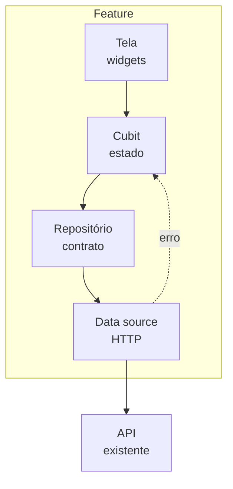
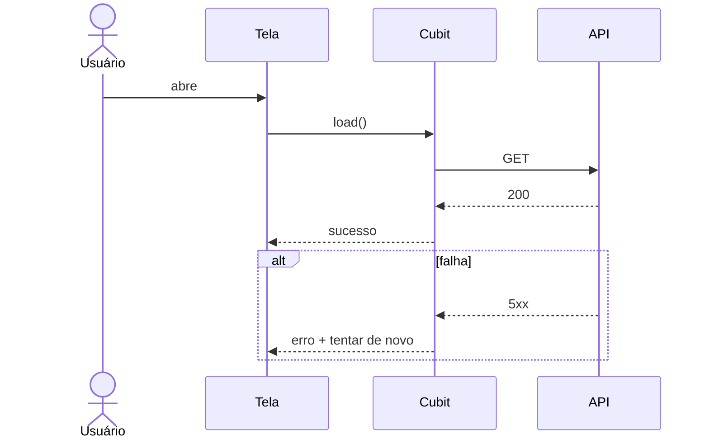
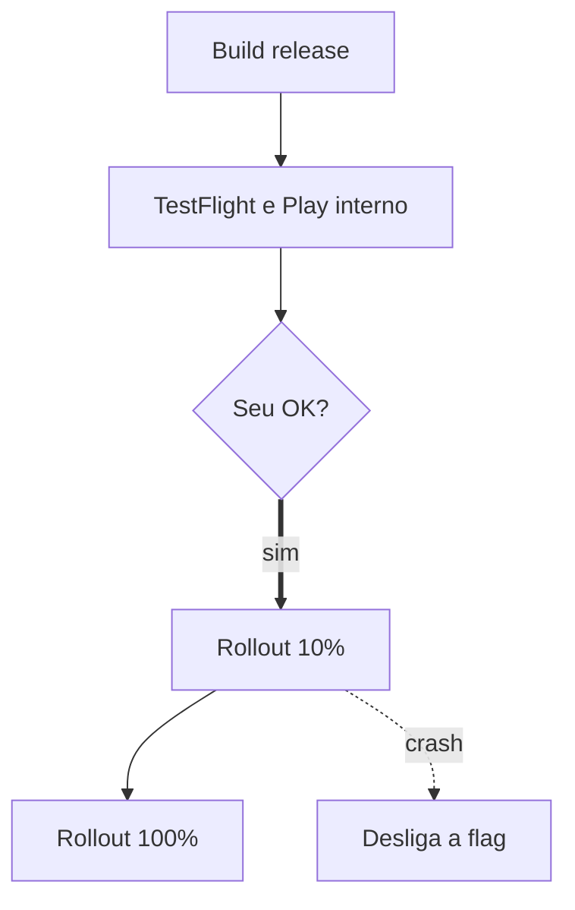

# Feature de app

Resumo do que muda para o usuário do app.

## Fontes
<!-- prompt: Leia Jira, Confluence e Figma. Uma linha por fonte com decisões e critérios. -->
| Fonte | O que decidiu | Critérios que traz |
|---|---|---|
| Figma | telas lidas | ver telas e estados |

## Telas e estados {#telas}
<!-- prompt: Cada tela com seus estados: loading, vazio, erro, sucesso, offline. Aponte frames que faltam no Figma. -->
| Tela | Estados | Frame no Figma |
|---|---|---|
| Lista | loading, vazio, erro, sucesso | a mapear |

## Design System {#ds}
<!-- prompt: Nó do Figma → componente do design system → variante → tokens. -->
| Nó no Figma | Componente | Variante |
|---|---|---|
| a mapear | a mapear | a mapear |

## Arquitetura
<!-- prompt: Camadas da feature e a interação principal com o ramo de falha. -->




## Estrutura de pastas {#estrutura}
```text
lib/features/nome/
  data/
  domain/
  presentation/
```

## Testes
- Unit, widget e bloc por arquivo, 90% de cobertura
- Flow E2E: emulador Android, depois simulador iOS

## Release
<!-- prompt: Como chega no usuário: feature flag, TestFlight e Play interno, rollout gradual, versão mínima, kill switch. A publicação nas lojas espera o OK do dev. -->
| Etapa | Onde | Critério para avançar |
|---|---|---|
| Interno | TestFlight e Play interno | smoke test nos dois |
| Rollout 10% | lojas | crash-free acima de 99,5% |
| 100% | lojas | 48 h sem regressão |



## Execução
```loops
- title: Camada de dados
  model: opus
  tasks:
    - {id: T1, title: Entidades e contratos, skill: clean-arch-layer-generator, model: opus, group: 1}
    - {id: T2, title: Data sources e repository, skill: clean-arch-layer-generator, model: sonnet, group: 2, after: [T1]}
    - {id: T3, title: Testes de dados, skill: unit-tests-handler, model: sonnet, group: 3, after: [T2]}
- title: Apresentação
  model: sonnet
  depends_on: [1]
  tasks:
    - {id: T4, title: Cubits, skill: cubit-state-creator, model: sonnet, group: 1}
    - {id: T5, title: Telas, skill: presentation-layer-scaffolder, model: sonnet, group: 1}
    - {id: T6, title: Eventos e logs, skill: event-bridge-implementer, model: haiku, group: 1}
- title: Wiring, E2E e release
  model: sonnet
  depends_on: [2]
  tasks:
    - {id: T7, title: DI e rota, skill: di-route-wirer, model: haiku, group: 1}
    - {id: T8, title: Flow Maestro Android → iOS, skill: maestro-e2e-scaffolder, model: sonnet, group: 2, after: [T7]}
    - {id: T9, title: Publicar nas lojas, skill: release, model: sonnet, group: 3, after: [T8], needs_ok: true}
```

## Pendências e riscos {#pendencias}
| Item | Impacto | Quem resolve |
|---|---|---|
| Frames de erro faltando no Figma | médio | design |
