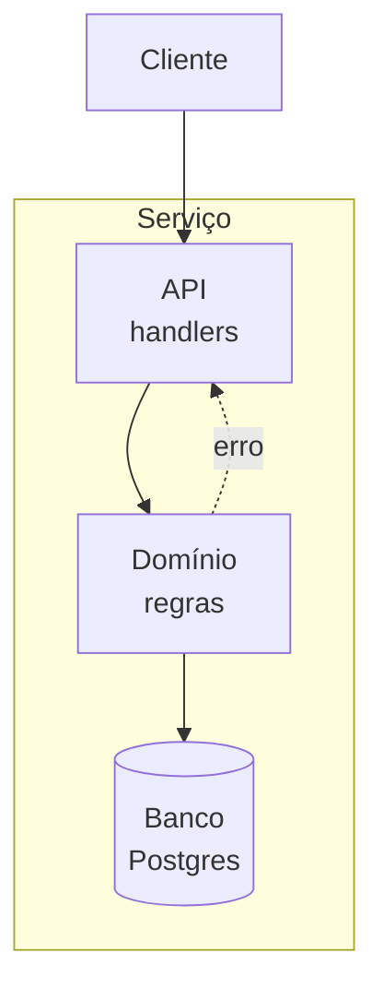
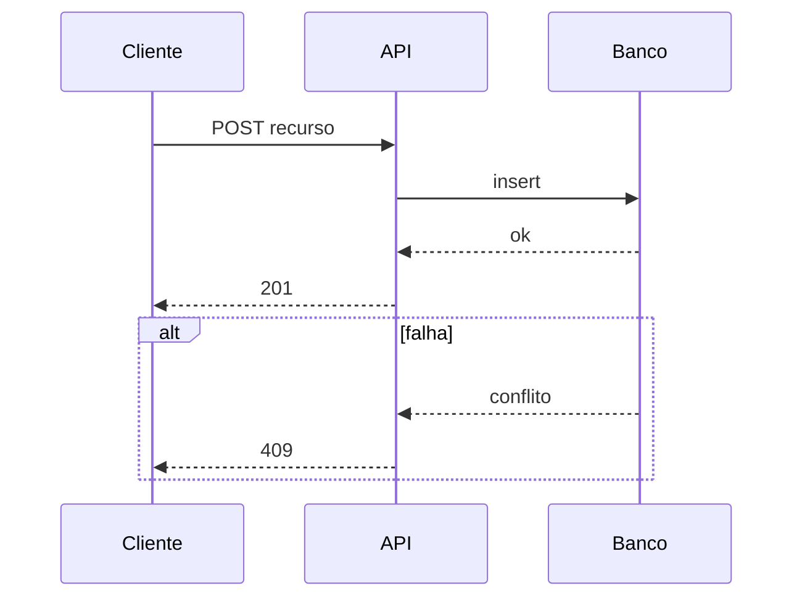
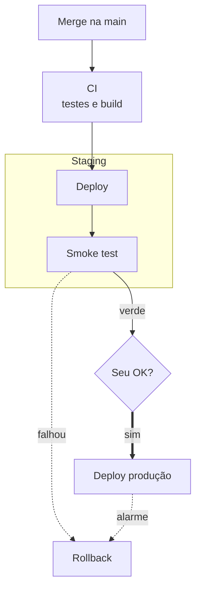

# Serviço novo

Resumo do que o serviço entrega e para quem.

## Fontes
<!-- prompt: Leia cada link (Jira, Confluence, Figma). Uma linha por fonte, com o que decidiu e os critérios de aceite que traz. Aponte conflitos entre fontes. -->
| Fonte | O que decidiu | Critérios que traz |
|---|---|---|
| Jira | resumo lido | ver checklist |

## Checklist
<!-- prompt: Responda pelas fontes e pelo código, marcando a origem. O que ficar aberto vira pendência. -->
| Item | Resposta | Origem |
|---|---|---|
| Métrica de sucesso | a confirmar | pendente |
| Contrato da API | a definir | pendente |
| PII / LGPD | o que nunca logar | dev |

## Arquitetura
<!-- prompt: Flowchart dos componentes e uma sequência da interação principal com o ramo de falha. Marque com :::new o que é criado. -->




## Contrato da API {#contrato}
<!-- prompt: Endpoints, request, response e códigos de erro. -->
```http
POST /v1/recurso
201 Created | 409 Conflict | 422 Unprocessable
```

## Dados e migrações {#dados}
<!-- prompt: Tabelas novas ou alteradas, índices e a estratégia de migração sem downtime. -->
| Tabela | Mudança | Migração |
|---|---|---|
| recurso | nova | expand → backfill → contract |

## Observabilidade
<!-- prompt: Logs, métricas e alertas; o que nunca logar. -->
- Métricas de latência e erro por endpoint
- Alerta de taxa de erro acima de 2%

## Testes
- Unit e integração com banco real em container
- Teste de contrato da API

## Deploy
<!-- prompt: Para cada provider, o que sobe e por qual MCP ou skill do catálogo, e se está configurado. Ambientes com gatilho, segredos (Keychain) e aprovação. Pipeline com rollback. Produção sempre espera o OK do dev. -->
| Provider | O que sobe | Via | No catálogo |
|---|---|---|---|
| Railway | serviço | use-railway + MCP railway | configurado |
| GCP | Cloud SQL ou Cloud Run | MCP gcloud | configurado |
| AWS | fila ou bucket | MCP aws | configurado |

| Ambiente | Gatilho | Segredos (Keychain) | Aprovação |
|---|---|---|---|
| staging | merge na main | STAGING | automática |
| produção | tag v* | a definir | seu OK |



## Execução
<!-- prompt: Um loop por PR; tarefas em grupos paralelos com skill e modelo. O deploy fecha e não gera PR. -->
```loops
- title: Contrato e domínio
  model: opus
  tasks:
    - {id: T1, title: Contrato da API, skill: backend-service, model: opus, group: 1}
    - {id: T2, title: Migração, skill: backend-service, model: sonnet, group: 2, after: [T1]}
    - {id: T3, title: Testes, skill: unit-tests-handler, model: sonnet, group: 3, after: [T2]}
- title: Handlers e observabilidade
  model: sonnet
  depends_on: [1]
  tasks:
    - {id: T4, title: Handlers, skill: backend-service, model: sonnet, group: 1}
    - {id: T5, title: Métricas e alertas, skill: log-instrumenter, model: haiku, group: 1}
- title: Deploy
  type: chore
  model: sonnet
  depends_on: [2]
  tasks:
    - {id: T6, title: Infra no provider, skill: MCP do provider, model: haiku, group: 1}
    - {id: T7, title: Deploy em staging, skill: use-railway, model: sonnet, group: 2, after: [T6]}
    - {id: T8, title: Smoke test, skill: run-test-learn, model: sonnet, group: 3, after: [T7]}
    - {id: T9, title: Deploy em produção, skill: use-railway, model: sonnet, group: 4, after: [T8], needs_ok: true}
```

## Pendências e riscos {#pendencias}
| Item | Impacto | Quem resolve |
|---|---|---|
| Escolher o provider de deploy | bloqueia | dev |
