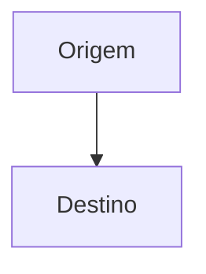

# Nome do plano

Resumo em uma frase: o que entrega e para quem.

## Fontes
<!-- Uma linha por fonte: o que ela decidiu e os critérios que traz. -->
| Fonte | O que decidiu | Critérios |
|---|---|---|
| Jira | a preencher | a preencher |

## Arquitetura
<!-- Fluxo dos componentes e a interação principal, com o ramo de falha. -->


## Execução
<!-- Loops do tamanho de um PR; tarefas com skill, modelo e grupo paralelo. -->
```loops
- title: Primeiro loop
  model: sonnet
  tasks:
    - {id: T1, title: Primeira tarefa, skill: a-definir, model: sonnet, group: 1}
```
