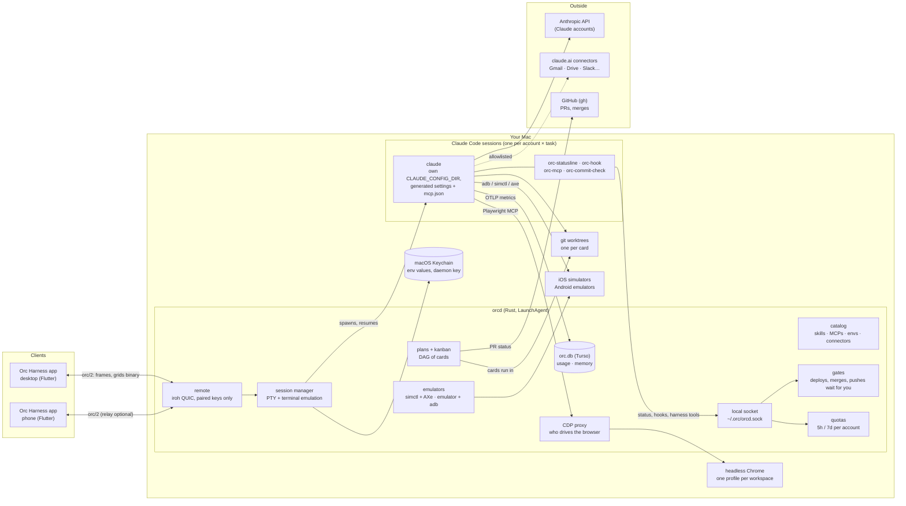
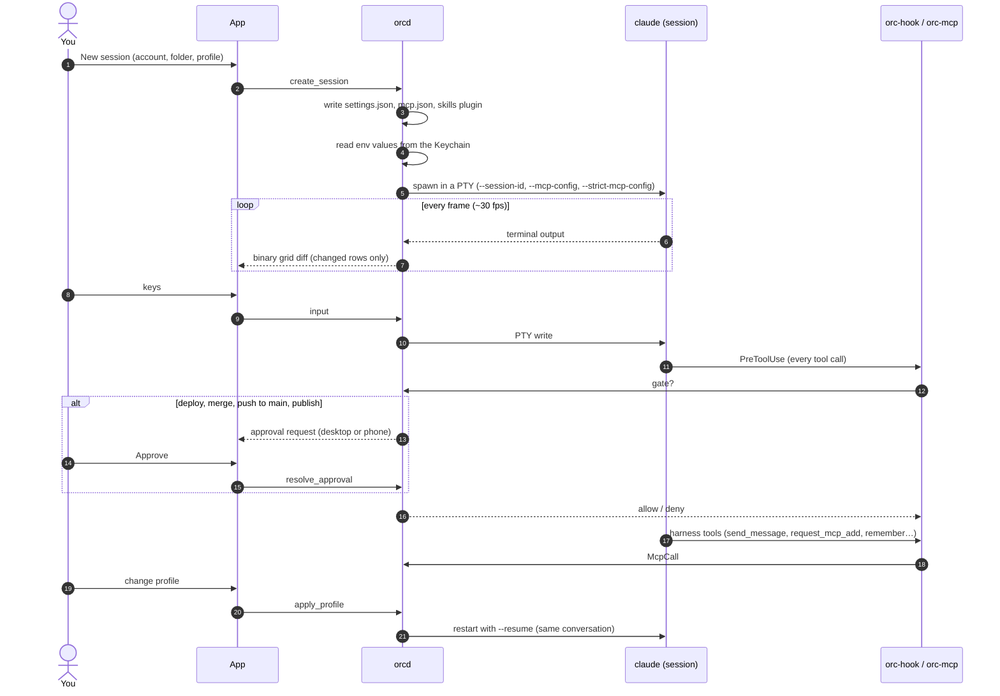
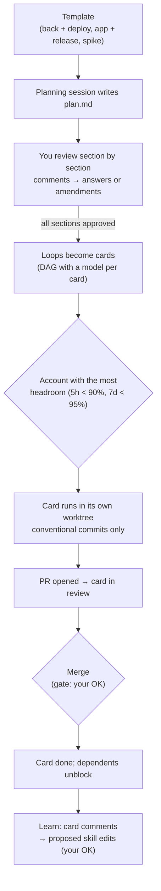
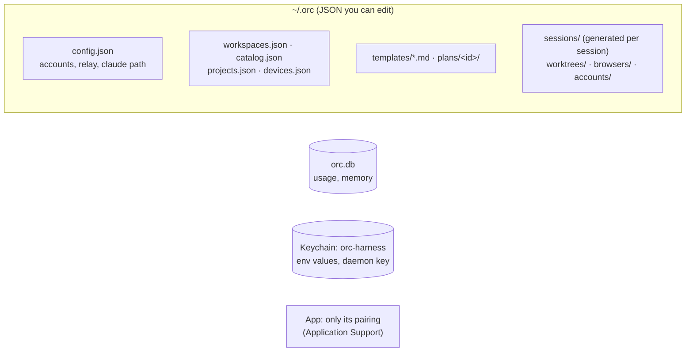

# How Orc Harness works

One daemon (`orcd`) on your Mac owns everything that runs: Claude Code sessions, their terminals, worktrees, browsers, emulators and secrets. The app, on the desktop and the phone, only shows what the daemon reports and sends back what you do.

## The big picture

## A session's life

## From a plan to merged code

## What lives where

Secrets never go in files, plans, logs or the app: env values live in the Keychain, configs carry `${NAME}` references, and the daemon puts the values in a session's environment when it starts it.
